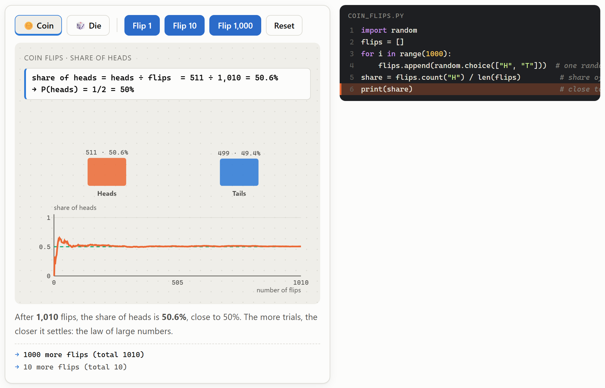
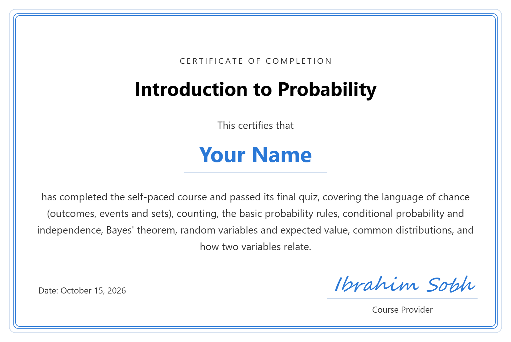

# Introduction to Probability

A **self-paced online course, completely free**, that teaches how to think clearly about chance: what probability means, how to count possibilities, how new information changes the odds (conditional probability and Bayes' theorem), and how random variables and common distributions describe uncertain quantities. High-level and concept-focused: only school arithmetic needed, no calculus and no coding.

<i>Created by <a href="https://www.linkedin.com/in/ibrahim-sobh-phd-8681757/">Ibrahim Sobh, PhD</a></i>

**The certificate is free too.** No sign-up and no fees: pass the final quiz and get a certificate with your name.

## 🚀 Take the course: [ibrahimsobh.github.io/introduction-to-probability](https://ibrahimsobh.github.io/introduction-to-probability/)

✅ Free · no sign-up · runs in your browser

## What you'll learn

- What probability means, and how to count outcomes and apply the basic rules.
- How new information changes chances: conditional probability, independence and Bayes' theorem.
- How random variables, expected values and common distributions describe real-world uncertainty.

## Main audience

Beginners who want an intuitive, concept-first introduction to probability. Only school arithmetic (fractions and percentages) is needed.

- **Students starting statistics, data science, computer science or engineering** who want the intuition before the formulas.
- **Professionals who work with data, risk or quality** (analysts, product managers, healthcare, finance, QA) who need to reason about chances, test results and rates.
- **Learners heading into AI and machine learning** who need probability as a foundation.
- **Curious adults** who want to make sense of odds, forecasts, medical tests and statistics in the news.

It isn't aimed at readers looking for proofs, measure theory, calculus-based derivations or exam-style problem drills.

## Course outline

**Part A · Chance and counting**

1. **Why probability?**: uncertainty in daily life; experiment, outcome and event; classical, frequency and subjective probability; the law of large numbers, seen live with 1,000 coin flips
2. **Sets and sample spaces**: the sample space Ω, events as sets, union, intersection and complement, Venn diagrams, and mutually exclusive events
3. **Counting**: the multiplication rule, factorials, and permutations (order matters) vs. combinations (it doesn't)
4. **Basic probability rules**: the three axioms in plain words, equally likely outcomes, the addition rule, and the complement rule ("at least one six")

**Part B · Updating with information**

5. **Conditional probability and independence**: P(A | B) as "zooming in", the multiplication (product) rule, independent events, and the gambler's fallacy
6. **Total probability and Bayes' theorem**: reasoning backwards from evidence, a medical test on 1,000 people, and why base rates matter

**Part C · Random variables**

7. **Random variables**: discrete vs. continuous, PMF, PDF and CDF, expected value, variance and standard deviation
8. **Common distributions**: Bernoulli, Binomial, Geometric, Poisson, Uniform, Exponential and Normal (with the 68-95-99.7 rule), and how to choose the right one
9. **More than one variable**: joint tables, the sum rule (marginalization) and product rule, covariance and correlation, and why correlation is not causation

## What each lesson gives you

- **A clear explanation** of the main idea, with an everyday analogy, simple diagrams and comparison tables. Every formula comes with a worked example in real numbers.
- **Interactive demos** you drive yourself: flip 1,000 coins, light up a Venn diagram, grow a counting tree, explore a deck of cards, zoom into 100 emails, test 1,000 people for a disease, play a dice game, explore seven distributions, and reveal the hidden cause behind a correlation.
- **Short Python sketches** beside each demo, with the step being run highlighted, so you see the same calculation as code (you don't need to run them).
- **A quiz in every lesson** (27 questions in total), plus a glossary and formula sheet to revise from.

**Example: the law of large numbers.** Flip a coin 10 times and the share of heads jumps around; flip it 1,000 times and the line settles right on 50% (here 50.6%), while the bars count heads and tails and the matching line of the simulation code lights up.

## How long it takes

About 3 hours if you're new to the topic, or about 1.5 hours if you already know some maths or statistics.

| Part | New to the topic | Already know some maths |
|---|---|---|
| Part A: 4 lessons | 4 × 15 min = 60 min | 4 × 8 min = 32 min |
| Part B: 2 lessons | 2 × 20 min = 40 min | 2 × 10 min = 20 min |
| Part C: 3 lessons | 3 × 20 min = 60 min | 3 × 10 min = 30 min |
| Glossary and formulas review | 10 min | 5 min |
| Final quiz and certificate | 15 min | 10 min |
| **Total** | **185 min ≈ 3 hours** | **97 min ≈ 1.5 hours** |

## Final quiz and certificate

Finish with the final quiz: 10 questions on the main concepts. Score 8 of 10 or more (80%) to get a certificate with your name, which you can download as an image or save as a PDF and share.

**Here's what your certificate looks like:**

Everything runs in your browser. Nothing you enter, including your name, is sent anywhere.
